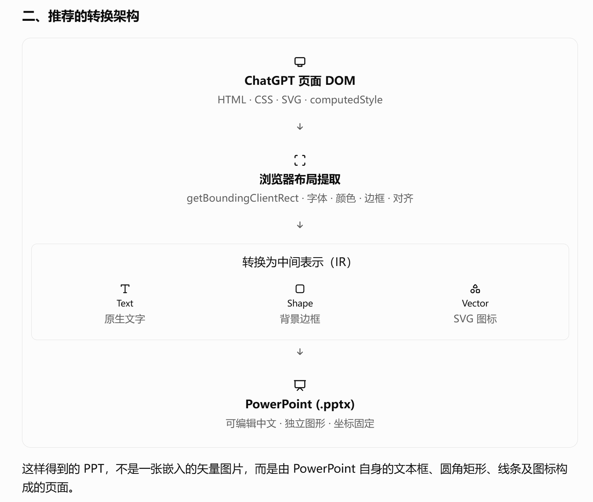
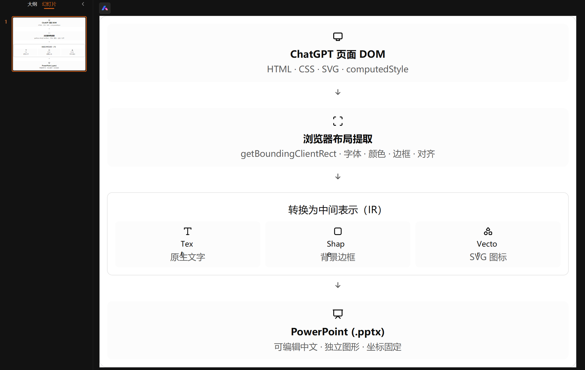

# ChatGPT Card to PPTX

一个 Tampermonkey 用户脚本：在 ChatGPT 页面点选卡片或其他 DOM 区域，导出为可编辑的 PowerPoint 文件。

本项目面向 ChatGPT 10 月更新后的富文本 UI 使用场景：回复中的卡片、横向布局、文字和图标可以组合成更丰富的内容。本工具将这些已渲染的区域提取为 PPTX，方便继续编辑和用于汇报。

本项目的用户脚本和文档全部由 **OpenAI Codex** 开发与编写，维护者负责提出需求、实际使用验证和发布。底层转换使用下方列出的第三方开源库。

[English instructions](#english)

## 效果展示 / Preview

左图为浏览器中的原始卡片，右图为导出后的 PPTX。导出文字及主题**默认使用 Microsoft YaHei UI 字体**；字体变化和转换过程可能带来排版差异。

Browser card (left) and exported PPTX (right). Exported text and theme fonts **use Microsoft YaHei UI by default**; font changes and conversion may affect the layout.

| 浏览器原始卡片 / Browser card | 导出后的 PPTX / Exported PPTX |
| --- | --- |
|  |  |

## 功能

- 鼠标悬停高亮区域，点击选中；优先选择 `data-d-component="box"`。
- 扩大到父级、缩回一级，按 Esc 取消选择。
- 普通文字和形状导出为 PPT 元素，SVG 保留矢量。
- 导出文件中的文字及主题字体统一为 **Microsoft YaHei UI**。
- 可选择是否包含 `::before` / `::after` 装饰，默认关闭。
- 点击“中文 / English”切换按钮、状态提示和功能描述；语言选择会保存。
- 显示导出阶段，转换超过 30 秒提示超时。
- 修正 JSZip 在用户脚本代理环境中的消息调度兼容问题。

## 安装

1. 在 Chrome 安装 [Tampermonkey](https://www.tampermonkey.net/)。
2. 打开 `chrome://extensions/`，进入 Tampermonkey 的详情，开启“允许用户脚本”，并允许访问 `chatgpt.com`。旧版本 Chrome 可按 Tampermonkey 提示启用开发者模式。
3. 点击 [安装用户脚本](https://raw.githubusercontent.com/Notte118/ChatGPT-Card-to-PPTX/main/chatgpt-card-export.user.js)，在 Tampermonkey 界面确认安装。如果显示源码，则新建脚本，将模板全部替换为 [`chatgpt-card-export.user.js`](./chatgpt-card-export.user.js) 的内容，保存。
4. 刷新 ChatGPT 页面，右下角应出现工具面板。

依赖通过固定版本的 `@require` 获取并由 Tampermonkey 缓存。首次安装需要能够访问 jsDelivr。

## 使用

1. 打开任意 `https://chatgpt.com/` 对话，等待回复生成完成。
2. 点击“选择区域”，鼠标移动查看蓝框，点击目标卡片。
3. 按需使用“扩大到父级”或“缩回一级”调整范围。
4. 点击“导出 PPTX”，从 Chrome 下载列表打开文件。

“装饰”开关只控制 CSS 伪元素。普通文字、背景、边框、圆角和 SVG 不受它影响。复杂装饰可能需要截图，建议先保持关闭。

## 转换范围

- 导出依赖浏览器中已经渲染的 DOM；页面外观与 PPT 可能存在差异。
- 图片和 Canvas 内容仍是图片，不能编辑其中的文字；SVG 可在支持的 PowerPoint 版本中转换为形状。
- SVG 内部的字体、图片中的文字不属于 PPT 文本字体统一的范围。
- 字体不嵌入文件；打开 PPT 的电脑应安装 Microsoft YaHei UI。
- 超时提示不会终止转换库内部任务；发生超时后请刷新页面再重试。
- 工具本身没有上传聊天内容的逻辑；转换库在处理图片等资源时可能加载它们的原始 URL。

## 依赖与许可

本项目采用 [MIT License](./LICENSE)。第三方依赖保持各自的许可：

- [dom-to-pptx](https://github.com/atharva9167j/dom-to-pptx)，固定版本 2.1.2，MIT License。
- [JSZip](https://github.com/Stuk/jszip)，固定版本 3.10.1，采用其 MIT 许可选项。

本项目是独立的社区工具，与 OpenAI/ChatGPT 无隶属关系。

## English

A Tampermonkey userscript that lets you select a ChatGPT card or page region and export it as an editable PowerPoint presentation.

This project targets the rich-text UI seen in ChatGPT after the October update: cards, rows, text and icons combined into richer responses. It exports these rendered regions to PPTX for further editing and presentations.

The userscript and documentation were developed and written entirely by **OpenAI Codex**. The maintainer provided requirements, validated the tool in actual use and published it. Conversion relies on the third-party open-source libraries credited below.

### Installation

1. Install [Tampermonkey](https://www.tampermonkey.net/) in Chrome.
2. Open `chrome://extensions/`, select Tampermonkey’s details, enable **Allow User Scripts** and grant access to `chatgpt.com`. On older Chrome versions, follow Tampermonkey’s instructions to enable Developer Mode.
3. [Install the userscript](https://raw.githubusercontent.com/Notte118/ChatGPT-Card-to-PPTX/main/chatgpt-card-export.user.js). If Chrome displays the source, create a new Tampermonkey script, replace the template with the full source, and save.
4. Refresh ChatGPT. The export panel appears in the lower right. Click **中文 / English** to switch languages; your choice is saved.

Dependencies use pinned `@require` versions and are cached by Tampermonkey. jsDelivr access is required for the initial download.

### Controls

| 中文 | English | Action |
| --- | --- | --- |
| 选择区域 | Select region | Hover to preview the outline, then click a card. |
| 扩大到父级 | Select parent | Expand the selection to its parent element. |
| 缩回一级 | Go back | Return to the previous, smaller selection. |
| 导出 PPTX | Export PPTX | Convert the selected region and download a PPTX. |
| 装饰：开 / 关 | Decorations: On / Off | Include or skip CSS `::before` / `::after` decorations. Default: Off. |
| 取消 / Esc | Cancel / Esc | Clear the selection or exit selection mode. |

### Export behavior

- Regular text and shapes become editable PPT elements; SVGs remain vector graphics.
- PPT text and theme fonts use **Microsoft YaHei UI**. The font must be installed on the computer opening the file; it is not embedded. Text inside SVGs and raster images is not changed.
- Complex effects may differ from the browser view. Images and Canvas content remain images.
- Conversion displays its current stage and reports a timeout after 30 seconds. Refresh the page before retrying a timed-out conversion.
- The script does not upload chat content. Processing images may load their original resource URLs.

Licensed under [MIT](./LICENSE). Uses [dom-to-pptx 2.1.2](https://github.com/atharva9167j/dom-to-pptx) and [JSZip 3.10.1](https://github.com/Stuk/jszip), under their MIT licenses. This is an independent community tool with no affiliation to OpenAI or ChatGPT.
